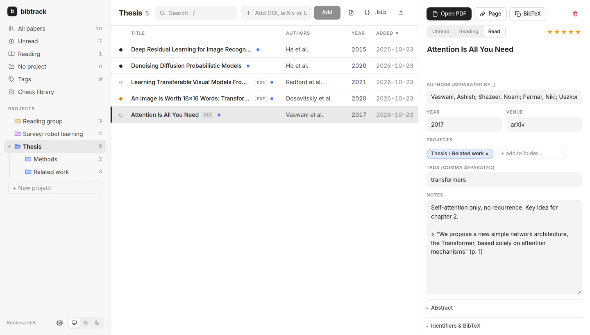

# bibtrack

**A fast, local-first paper library: Zotero's capture and organisation, JabRef's BibTeX workflow, and full access for AI agents.**

Save a paper from any web page with one click, file it into your project folders, search inside every PDF,
and keep a `.bib` file per project always up to date for LaTeX. Everything lives in a plain JSON file in a
folder you already sync (Dropbox, Syncthing, Nextcloud, …), so every machine sees the same library.
There's no account and no proprietary cloud.

Through its [MCP](https://modelcontextprotocol.io) server, an agent such as Claude, Gemini, ChatGPT/Codex or Cursor can
run the whole library from a prompt. For example:

> *"Find the papers in my Thesis folder that discuss proxemics, read their PDFs and write me a related-work paragraph with \cite keys."*
> *"Add arXiv 2406.09246 to Survey › Robot learning and tag it vla."*
> *"Check my library for duplicates and broken metadata, and fix what you can."*

<picture>
  <source media="(prefers-color-scheme: dark)" srcset="docs/screenshot-dark.png">
  
</picture>

## Why bibtrack?

- **Your data, plain and portable.** One `library.json`, a `pdfs/` folder and auto-generated `.bib` files. You can read, diff or back them up, and edit them with any tool.
- **Sync through what you already have.** Put the folder in Dropbox or any synced folder and you're done. Concurrent edits from two machines are merged automatically, including Dropbox's "conflicted copies".
- **Fast.** It's a web app running locally, so search is instant as you type. It searches metadata, notes and the full text of every PDF.
- **One-click capture.** A browser extension (Firefox, Zen, Chrome) or a bookmarklet reads the citation data of the page you're on. Crossref and arXiv then complete it, and the PDF is downloaded when it's open access.
- **BibTeX without the busywork.** Every folder has an always-current `.bib` file. Citation keys follow a JabRef-style pattern, and you can edit any entry's raw BibTeX.
- **Agent-native.** 15 MCP tools give an AI agent the same powers you have in the UI, including reading PDFs.
- **Small and hackable.** About 3k lines of TypeScript, using Express + React + Vite.

## bibtrack vs Zotero vs JabRef

|                                   | **bibtrack**                                               | **Zotero**                                     | **JabRef**                                  |
| --------------------------------- | ---------------------------------------------------------- | ---------------------------------------------- | ------------------------------------------- |
| Storage                           | Plain JSON + PDFs in a folder you choose                    | SQLite database (not safe in a synced folder)  | `.bib` files                                |
| Sync between machines             | Any synced folder (Dropbox…); conflicts auto-merged         | Zotero account (300 MB free) or WebDAV         | Manual / shared `.bib`                      |
| App                               | Local web app in your browser                               | Desktop app                                    | Desktop app (Java)                          |
| One-click capture from the web    | ✅ extension / bookmarklet                                   | ✅ Zotero Connector (more site translators)    | ⚠️ via browser extension / fetchers          |
| Folders                           | Nested folders, a paper can be in many                      | Nested collections                             | Groups                                      |
| Full-text search in PDFs          | ✅                                                           | ✅                                             | ⚠️ (Lucene index, optional)                  |
| BibTeX per project, auto-updated  | ✅ built in                                                  | Needs the Better BibTeX plugin                 | ✅ (it *is* the `.bib`)                      |
| Citation-key patterns             | ✅ JabRef-style                                              | Better BibTeX plugin                           | ✅                                           |
| Duplicate detection & merge       | ✅                                                           | ✅                                             | ✅                                           |
| Integrity check / metadata fixer  | ✅ (flags placeholders, finds metadata from PDF or Crossref) | ⚠️ "Retrieve metadata for PDF"                 | ✅ integrity check, many fetchers            |
| PDF annotation in the app         | ❌ (opens your PDF viewer; Zotero highlights import as notes) | ✅ excellent                                   | ❌                                           |
| Word / LibreOffice citation plugin| ❌ (LaTeX/BibTeX workflow)                                   | ✅                                             | ⚠️ LibreOffice only                         |
| Mobile apps                       | ❌                                                           | ✅                                             | ❌                                           |
| **AI agent access (MCP)**         | ✅ **full read/write, incl. PDF text**                       | ❌ (third-party, mostly read-only)             | ❌                                           |
| Migrate from the others           | ✅ one-command Zotero import, `.bib` import                  | –                                              | –                                           |

**When Zotero is still the better choice:** you annotate PDFs heavily inside the app, you write in Word, you need group
libraries shared with other people, or you want mobile apps. bibtrack is built for people who write in LaTeX, live in
the browser, and want an agent to do the bookkeeping.

## Features

- **Capture:** browser extension and bookmarklet; add by DOI, arXiv ID, URL or title; drop PDFs to create entries (the DOI or arXiv ID is read from the PDF); `.bib` import.
- **Organise:** nested folders (move, rename, delete); tags (search popup, `t`); read status; 5-star rating; notes.
- **Search:** instant metadata search plus full-text search inside PDFs, with an "in PDF" snippet.
- **BibTeX:**
  - `bib/<Folder>.bib` and `bib/library.bib` are kept up to date automatically.
  - Each folder has a `{}` button to copy or download its BibTeX.
  - You can edit an entry's raw BibTeX.
  - Citation-key patterns with a live preview; you can regenerate all keys.
- **Library check:**
  - Finds duplicates, which you can merge.
  - Flags missing or placeholder fields (`PAPER_TITLE`, impossible years, …) and papers without PDF or DOI.
  - *Find metadata* looks up correct details from the DOI or arXiv ID printed in the PDF, or from Crossref.
- **Sync:** atomic writes; live reload when another machine changes the library; Dropbox conflicted copies are merged.
- **Agents:** MCP server with 15 tools (below).
- **Zotero migration:** papers, nested collections, tags, notes, PDFs and PDF highlights (copied into notes).

## Install

Requires Node.js ≥ 22.

```sh
git clone git@github.com:lulilac/bibtrack.git ~/bibtrack
cd ~/bibtrack
npm install
npm run build
npm start                      # → http://localhost:5577
```

The library goes to `~/Dropbox/bibtrack` by default. Set `BIBTRACK_DIR` to use another folder, and `PORT` to change
the port (5577). Use the same port on every machine, because the browser extension points at it.

### Start automatically at login (Linux, systemd)

```sh
sed "s|%h/bibtrack|$PWD|" bibtrack.service > ~/.config/systemd/user/bibtrack.service
systemctl --user daemon-reload && systemctl --user enable --now bibtrack
```

### Browser capture

- **Extension (Firefox, Zen, Chrome):** the `extension/` folder. It adds a toolbar button, also on <kbd>Alt</kbd>+<kbd>Shift</kbd>+<kbd>B</kbd>.
  - **Chrome:** `chrome://extensions` → Developer mode → *Load unpacked*.
  - **Firefox/Zen, quick try:** `about:debugging` → *Load Temporary Add-on* → `extension/manifest.json`.
  - **Firefox/Zen, permanent:** sign it once as a private add-on, then open the `.xpi` it creates:
    ```sh
    npx web-ext sign -s extension --channel=unlisted --api-key=… --api-secret=…
    ```
    The keys come from https://addons.mozilla.org/developers/addon/api/key/.
- **Bookmarklet:** open http://localhost:5577/bookmarklet and drag the button to your bookmarks bar.

### Migrating from Zotero

```sh
npm run import:zotero -- --dry-run     # preview
npm run import:zotero                  # finds ~/Zotero, snap and flatpak installs (or pass a path)
```

This imports items, the nested collection tree, your own tags, notes, PDFs and PDF highlights (as quoted notes with page
numbers). Zotero can stay open while it runs. Re-running is safe: it never duplicates papers and never overwrites what
you changed in bibtrack.

## Use it from an AI agent (MCP)

The MCP server works on the same library as the web app; open browser tabs update live. Replace `/path/to/bibtrack`
with your clone (e.g. `~/bibtrack`).

**Claude Code**
```sh
claude mcp add bibtrack -- /path/to/bibtrack/node_modules/.bin/tsx /path/to/bibtrack/server/mcp.ts
```

**Claude Desktop, Cursor, VS Code, Gemini CLI**: add this to `claude_desktop_config.json`, `.cursor/mcp.json`, `.vscode/mcp.json` or `~/.gemini/settings.json`:
```json
{
  "mcpServers": {
    "bibtrack": {
      "command": "/path/to/bibtrack/node_modules/.bin/tsx",
      "args": ["/path/to/bibtrack/server/mcp.ts"]
    }
  }
}
```

**OpenAI Codex CLI** (`~/.codex/config.toml`)
```toml
[mcp_servers.bibtrack]
command = "/path/to/bibtrack/node_modules/.bin/tsx"
args = ["/path/to/bibtrack/server/mcp.ts"]
```

Add `"env": { "BIBTRACK_DIR": "…" }` (or `env = { … }` for Codex) if your library is not in `~/Dropbox/bibtrack`.

| Tool | What it does |
| --- | --- |
| `search_papers` | Search metadata, notes, tags, and optionally PDF full text; filter by folder, tag or status |
| `get_paper` | All fields of a paper, including notes and folders |
| `read_pdf` | Text of a paper's PDF, by page range |
| `add_paper` | Add by DOI, arXiv ID, URL or title, into folders, with tags and notes |
| `update_paper`, `set_paper_folders`, `delete_paper` | Edit papers and their folders |
| `list_folders`, `create_folder`, `update_folder`, `delete_folder` | Manage the folder tree (paths like `"Thesis › Methods"`) |
| `export_bibtex` | BibTeX for a folder, some papers, or everything |
| `check_library`, `find_metadata`, `merge_papers` | Duplicates, broken metadata, fixes |

[AGENTS.md](AGENTS.md) describes the data model and conventions for agents working on the library or the code.

## How it works

```
browser extension / bookmarklet ──► http://localhost:5577 (Express) ─┐
web UI (React + Vite) ◄──── REST + server-sent events ───────────────┤
AI agent ◄──── MCP (stdio) ──── server/mcp.ts ───────────────────────┤
                                                                     ▼
                                           server/library.ts  (one service, used by both)
                                                                     │
                     ~/Dropbox/bibtrack/  library.json · pdfs/ · fulltext/ · bib/ · backups/
```

| Path | |
| --- | --- |
| `server/library.ts` | All library operations (add, edit, folders, BibTeX, full text, check, merge) |
| `server/index.ts` | HTTP API and static web app |
| `server/mcp.ts` | MCP server for agents |
| `server/store.ts` | `library.json`: atomic writes, live reload, Dropbox conflict merging |
| `server/metadata.ts` | Crossref / arXiv / page metadata, BibTeX parse and format |
| `server/fulltext.ts` | PDF text extraction (pdf.js) and search |
| `server/import-zotero.ts` | Zotero migration |
| `shared/` | Data model, folder tree helpers, citation-key patterns |
| `web/` | React UI |
| `extension/` | Browser extension |

Development: `npm run dev` runs the server with reload plus Vite on http://localhost:5578. `npm run typecheck` checks the types.

## Roadmap

- Citation graph: papers citing / cited by a paper (Semantic Scholar / OpenAlex), with one-click add
- New-paper alerts: arXiv / journal RSS feeds and saved searches
- In-browser PDF reader with highlights stored as notes
- Related-paper suggestions from your folders
- Remote MCP endpoint (for ChatGPT and other web agents) with authentication
